

  <a href="https://flick.systems"></a>

  <a href="https://chaos.flick.systems"></a>
  <a href="https://flick.systems"></a>
  <a href="https://flick.systems/resume/"></a>
  


  <a href="https://industrial-cleaning-services.vercel.app"></a>
  <a href="https://campmackcookies.vercel.app"></a>

  <a href="https://dilly-rays-sweet-heat.vercel.app"></a>
  <a href="https://taxguyokc.vercel.app"></a>

  <a href="https://r3dpill-ai.vercel.app"></a>
  <a href="https://automax-eosin.vercel.app"></a>

<code>SRC //</code>
  <a href="https://github.com/thewimybarbarian/industrial-cleaning-services">industrial-cleaning-services</a> ·
  <a href="https://github.com/thewimybarbarian/campmackcookies">campmackcookies</a> ·
  <a href="https://github.com/thewimybarbarian/dilly-rays-sweet-heat">dilly-rays-sweet-heat</a> ·
  <a href="https://github.com/thewimybarbarian/taxguyokc">taxguyokc</a> ·
  <a href="https://github.com/thewimybarbarian/r3dpill-ai">r3dpill-ai</a> ·
  <a href="https://github.com/thewimybarbarian/automax">automax</a>



  <a href="https://chaos.flick.systems"></a>

